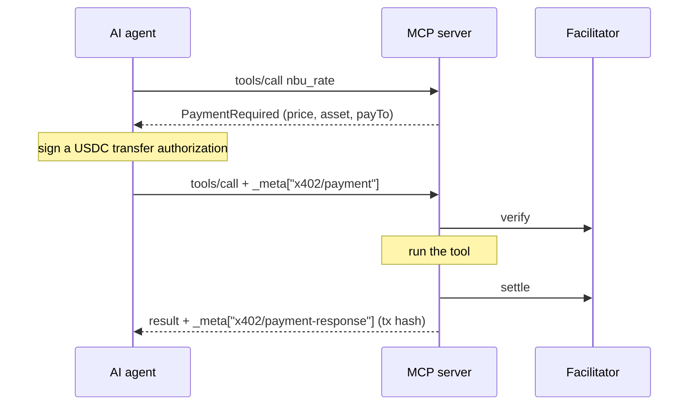

<!-- readme:header:start -->
<p>
  
  <a href="https://github.com/Egoushka/x402-mcp-dotnet/actions/workflows/ci.yml"></a>
  
</p>
<!-- readme:header:end -->

# x402-mcp-dotnet

> Paid MCP tools for .NET: mark a tool [PaidTool] and an AI agent pays for each call in USDC before it runs.

<!-- readme:status:start -->
**Active**. I work on it this month.
<!-- readme:status:end -->



## Why

[x402](https://www.x402.org) is a protocol for paying per request with a stablecoin: the server answers "payment
required" with a price, and the client retries with a signed payment. The .NET x402 libraries I found cover HTTP
endpoints. I wanted the same for MCP (Model Context Protocol) tool calls, so an agent can buy one tool call at a
time without an account or an API key.

## What it does

- **Paid tools with one attribute.** `[PaidTool("1000")]` on a tool charges 0.001 USDC per call; tools without it
  stay free. Price, asset, recipient and network can be set per tool.
- **A paying client.** `CallPaidToolAsync` pays only when the server asks, and only within the wallet's allowances.
- **No charge for failed work.** If the tool throws or returns an error, nothing is settled.
- **No keys on the server.** The payer signs; a facilitator (an x402 service that checks and submits payments)
  moves the USDC on chain.

It implements the [x402 v2 MCP transport](https://github.com/coinbase/x402/blob/main/specs/transports-v2/mcp.md)
for the official [ModelContextProtocol C# SDK](https://github.com/modelcontextprotocol/csharp-sdk), on top of
[michielpost/x402-dotnet](https://github.com/michielpost/x402-dotnet) for the protocol types, the facilitator
client and the EVM wallet.

Not here: the `upto` scheme (charge by usage), a mainnet run, and payment by MCP hosts on their own; the
[limits](docs/explanation/payment-checks.md#limits) say more.

## Quick start

Not on NuGet yet (package id `Egoushka.X402.Mcp`; the release workflow is in place). Until the first release,
clone the repo and reference the project. Targets .NET 10.

```bash
git clone https://github.com/Egoushka/x402-mcp-dotnet
dotnet add reference x402-mcp-dotnet/src/X402.Mcp/X402.Mcp.csproj
```

Server:

```csharp
builder.Services.WithHttpFacilitator("https://x402.org/facilitator/");
builder.Services.AddMcpServer()
    .WithHttpTransport()
    .WithTools<RateTools>()
    .WithX402Payments(o => o.PayTo = "0xYourAddress");

[McpServerToolType]
public sealed class RateTools
{
    [McpServerTool(Name = "nbu_rate"), PaidTool("1000")] // 0.001 USDC per call
    public static Task<string> NbuRate(string currency) => ...;
}
```

Agent:

```csharp
var result = await mcpClient.CallPaidToolAsync("nbu_rate", args, wallet);
var receipt = result.GetPaymentSettlement(); // tx hash, payer, network
```

`dotnet test` runs a real MCP client and server in process, signs with a real EVM key and uses a fake
facilitator. To pay on the public testnet, see [run the samples](docs/how-to/run-the-samples.md).

## How it works

A call to a paid tool without payment gets an MCP error result whose `structuredContent` is the x402
PaymentRequired: price, asset, network and recipient. The client signs an EIP-3009 authorization (a signed
"move this much USDC to that address" message) and repeats the call with it in `_meta["x402/payment"]`.

The server checks the payment is for this tool (`mcp://tool/{name}`) and matches price, asset, network and
recipient exactly, then asks the facilitator to verify it, runs the tool, and settles only if the tool succeeded.
If settlement fails, the tool's output is withheld. The receipt goes back in `_meta["x402/payment-response"]`.

## Docs

- [Server reference](docs/reference/server.md): `[PaidTool]` and `X402McpOptions`, every property and default.
- [Client reference](docs/reference/client.md): wallet allowances, `CallPaidToolAsync`, reading receipts and refusals.
- [What the server checks](docs/explanation/payment-checks.md): each failure path and the known limits.
- [Run the samples](docs/how-to/run-the-samples.md): the sample server and agent against the x402.org testnet.

<!-- readme:footer:start -->
---

<sub>Made by [Yehor Hrabovskyi](https://hrabovskyi.online) · [MIT licence](LICENSE).</sub>
<!-- readme:footer:end -->
